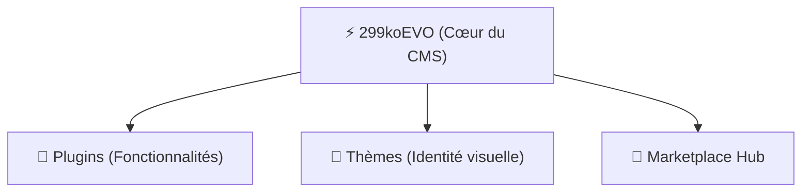

<div align="center">

# ⚡ 299koEVO

### *Your website. Your data. Your freedom.*
**Un CMS qui vous appartient vraiment. Léger, modulaire et indépendant.**

[](https://github.com/NemStudio18/299koEVO/releases)
[](https://www.php.net/)
[](LICENSE)
[](https://299ko.flexcb.fr)
[](#05--stockage--architecture)

[🇬🇧 Read in English](README.md) • [🌐 Démo en direct](https://299ko.flexcb.fr/) • [💬 GitHub Discussions](https://github.com/NemStudio18/299koEVO/discussions) • [📦 Télécharger (v0.4.3)](https://github.com/NemStudio18/299koEVO/releases)

---

### 🖥️ Aperçu de l'interface

| 🌐 Site Public Officiel | ⚡ Administration & Tableau de bord |
| :---: | :---: |
| [](https://299ko.flexcb.fr) | [](https://299ko.flexcb.fr) |

<details>
<summary>🌙 <b>Cliquez ici pour voir l'administration en Mode Sombre (Dark Mode)</b></summary>

<br>

[](https://299ko.flexcb.fr)

</details>

---

### Deux parcours pour commencer :

| 🚀 Je veux créer mon site (Parcours Utilisateur) | 🛠️ Je veux développer (Parcours Développeur) |
| :--- | :--- |
| Installez 299koEVO en 30 secondes sans base de données, personnalisez votre thème et activez vos modules en un clic. | Explorez l'architecture, créez des plugins ou des thèmes avec des hooks simples, et participez au cœur du CMS. |
| 👉 **[Tester la démo](#-tester-sans-installer--démo-en-direct)** • **[Guide d'installation](#03--démarrer--installation-en-3-étapes)** | 👉 **[Architecture](#05--stockage--architecture)** • **[Guide de contribution](CONTRIBUTING.md)** |

---

</div>

## 01 — Découvrir 299koEVO

**299koEVO** est un système de gestion de contenu (CMS) moderne conçu autour d'une idée simple : **créer et administrer un site web ne devrait jamais vous obliger à abandonner le contrôle de vos outils, de vos contenus ou de vos données.**

Le projet repose sur 3 piliers fondateurs :
- 🪶 **Légèreté** : Ne pas imposer une infrastructure disproportionnée. Fonctionne sur un simple hébergement mutualisé ou un VPS économique.
- 🕊️ **Liberté** : Choisir comment concevoir son site, sans publicité, sans traqueurs tiers et sans formats fermés.
- 🛡️ **Indépendance** : Ne dépendre d'aucune entreprise commerciale ni d'aucun service cloud propriétaire (pas de Google reCAPTCHA, pas de CDN obligatoire).

> **Un projet indépendant à visage humain**  
> 299koEVO n'est pas édité par une société commerciale. C'est un logiciel libre durable, maintenu avec passion et transparence, pensé pour les créateurs de sites, les associations, les indépendants et les passionnés du Web souverain.

---

## 02 — Pourquoi 299koEVO ?

Face aux solutions traditionnelles devenues des usines à gaz complexes et lentes, 299koEVO propose un retour à la performance brute et à la simplicité :

| CMS traditionnels | ⚡ L'expérience 299koEVO |
| :--- | :--- |
| ❌ Base de données MySQL obligatoire et lourde à administrer | ✅ **Prêt à l'emploi en JSON plat**. Déposez les fichiers et votre site tourne instantanément. |
| ❌ Requêtes lentes, temps de chargement > 1 à 2 secondes | ✅ **Temps de réponse inférieur à 50 ms**. Léger pour les serveurs et éco-conçu. |
| ❌ Dépendance aux géants du Web (Google reCAPTCHA, Google Fonts, CDN tiers) | ✅ **100% souverain**. Antispam cryptographique autonome (`299nobot`), zéro pistage des visiteurs. |
| ❌ Mises à jour complexes avec risques de casser la base de données | ✅ **Marketplace intégrée**. Installez et mettez à jour vos modules en 1 clic. |
| ❌ Panneaux d'administration surchargés et confus | ✅ **Interface épurée et moderne**, avec support natif du Mode Sombre (*Dark Mode*). |

---

## 03 — Démarrer : Installation & Démo

### 🌐 Tester sans installer : Démo en direct
Envie de voir à quoi ressemble l'administration avant d'installer ?  
Visitez notre vitrine officielle en ligne : **[299ko.flexcb.fr](https://299ko.flexcb.fr/)**

---

### 📋 Prérequis
- **PHP 8.1 ou supérieur** (recommandé : PHP 8.2 / 8.3 / 8.4)
- Extensions PHP : `json`, `mbstring`, `gd` (ou `imagick`), `zip`, `pdo_sqlite` (recommandé)
- Serveur web : Apache (`mod_rewrite` activé, `.htaccess` inclus) ou Nginx

### ⚡ Installation en 3 étapes

1. **Téléchargez** la dernière archive stable depuis la [page des Releases](https://github.com/NemStudio18/299koEVO/releases) (ou clonez ce dépôt) :
   ```bash
   git clone https://github.com/NemStudio18/299koEVO.git mon-site
   cd mon-site
   ```
2. **Déposez** les fichiers à la racine de votre hébergement web.
3. **Ouvrez** votre site dans votre navigateur : l'assistant visuel d'installation (`install.php`) vous guide en 30 secondes pour créer votre compte administrateur. Supprimez ensuite `install.php`.

---

## 04 — Explorer l'écosystème

L'écosystème 299koEVO est modulaire et s'articule autour de trois dépôts complémentaires :

<div align="center">



</div>

### 1. [Le Cœur CMS (`NemStudio18/299koEVO`)](https://github.com/NemStudio18/299koEVO)
Le moteur d'exécution, le routeur AltoRouter, l'administration moderne (`PluginsManager 2.0`), la médiathèque centralisée (`FileManager`), la supervision temps réel (`SystemMonitor`), l'ordonnanceur de tâches (`TaskScheduler`), l'audit d'intégrité (`DataInspector`), la gestion des utilisateurs ABAC et le système de cache.

### 2. [Le Catalogue des Plugins (`NemStudio18/Plugins_299koEVO`)](https://github.com/NemStudio18/Plugins_299koEVO)
Plus de 40 modules prêts à l'emploi installables en 1 clic :
- **🏷️ Petites Annonces (`annonces` - C2C)** : Dépôt public, modération admin, multi-photos WebP et messagerie acheteur/vendeur.
- **🛒 E-commerce (`ecommerce` - B2C)** : Boutique en ligne, gestion des stocks, passerelle Stripe Checkout et suivi colis.
- **📝 Blog & Articles** : Publication programmée à la minute, catégories, pagination fluide, flux RSS et commentaires.
- **⚡ Workflow (No-Code)** : Orchestrateur d'événements automatisés (déclencheurs, conditions, Webhooks HTTP, e-mails et tâches différées).
- **📊 LightStats** : Statistiques souveraines auto-hébergées, sans cookies tiers, 100% conformes CNIL / RGPD.
- **💬 LiveChat, Agenda, FAQ, Forum, Sondages, Galerie photos, Arcade Rétro (`game`)...**

### 3. [Le Catalogue des Thèmes (`NemStudio18/Skins_299koEVO`)](https://github.com/NemStudio18/Skins_299koEVO)
Des thèmes modernes, responsives et compatibles avec les Design Tokens universels `--evo-*` (`Declic`, `default`, `Noel`, `CyberDark`, etc.).

---

## 05 — Stockage & Architecture

299koEVO utilise une couche d'abstraction (`JsonActiveRecord`) qui permet de démarrer sans base de données et d'évoluer selon votre trafic.

### Comparatif transparent des modes de stockage

| Moteur | Cas d'usage idéal | Forces | Limites à connaître |
| :--- | :--- | :--- | :--- |
| **📁 JSON (Défaut)** | Sites vitrines, blogs personnels, portfolios, documentations. | Zéro configuration. Déplacez ou sauvegardez votre site par un simple copier-coller de dossier. | Déconseillé au-delà de plusieurs dizaines de milliers d'enregistrements simultanés ou fortes écritures concurrentes. |
| **🪶 SQLite** | Sites associatifs, portails régionaux, commerces de taille moyenne. | La puissance du SQL dans un fichier unique, sans serveur de base de données à administrer. | Performances excellentes en lecture ; les écritures concurrentes massives restent sérialisées par le verrou fichier. |
| **🐬 MySQL / MariaDB** | Fort trafic, plateformes communautaires, gros catalogues e-commerce. | Scalabilité maximale, requêtes concurrentes massives et hébergements distribués. | Nécessite un serveur de base de données actif et des identifiants de connexion. |

---

## 06 — Rejoindre la communauté

Vous n'avez pas besoin d'être un développeur chevronné pour participer. Chacun a sa place dans la communauté 299koEVO :

### Si vous êtes utilisateur :
- 🚀 **[Présentez votre site](https://github.com/NemStudio18/299koEVO/discussions/categories/presentez-votre-site)** : Montrez ce que vous avez construit avec 299koEVO !
- 💡 **[Partagez vos idées](https://github.com/NemStudio18/299koEVO/discussions/categories/idees-et-suggestions)** : Dites-nous ce qui vous manque ou ce qui pourrait être amélioré.
- 🆘 **[Besoin d'aide ?](https://github.com/NemStudio18/299koEVO/discussions/categories/aide-et-installation)** : Posez vos questions d'installation ou de configuration.

### Si vous êtes développeur ou designer :
- 🧩 **Créer un plugin ou un thème** : Proposez vos extensions sur [Plugins_299koEVO](https://github.com/NemStudio18/Plugins_299koEVO) ou [Skins_299koEVO](https://github.com/NemStudio18/Skins_299koEVO).
- 🐛 **Signaler un bug** : Ouvrez une [Issue GitHub](https://github.com/NemStudio18/299koEVO/issues) détaillée.
- 💻 **Contribuer au code** : Lisez notre [Guide de Contribution (CONTRIBUTING.md)](CONTRIBUTING.md) et notre [Code de Conduite (CODE_OF_CONDUCT.md)](CODE_OF_CONDUCT.md).
- 🔒 **Signaler une vulnérabilité** : Respectez la procédure confidentielle décrite dans [SECURITY.md](SECURITY.md).

---

## 07 — Statut du projet & Feuille de route

Le projet est activement maintenu en version **v0.4.3**.  
Consultez notre feuille de route détaillée dans **[ROADMAP.md](ROADMAP.md)** pour découvrir les jalons réalisés et à venir (TaskScheduler, SystemMonitor, DataInspector, Snapshots de sécurité, Moteur de Workflows No-Code, Tokens CSS universels).

---

## 08 — Gouvernance, Licence & Crédits

- **Gouvernance & Pérennité** : Découvrez comment le projet est organisé, comment les décisions sont prises et comment sa longévité est garantie dans **[GOVERNANCE.md](GOVERNANCE.md)**.
- **Licence** : 299koEVO est un logiciel libre distribué sous licence **[GNU General Public License v3.0 (GPLv3)](LICENSE)**.
- **Crédits** : Conçu et développé par [NemStudio18](https://github.com/NemStudio18) et la communauté des contributeurs de 299koEVO.
