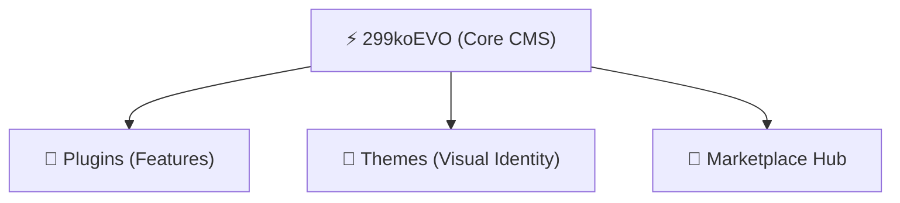

<div align="center">

# ⚡ 299koEVO

### *Your website. Your data. Your freedom.*
**A CMS that truly belongs to you. Lightweight, modular, and independent.**

[](https://github.com/NemStudio18/299koEVO/releases)
[](https://www.php.net/)
[](LICENSE)
[](https://299ko.flexcb.fr)
[](#05--storage--architecture)

[🇫🇷 Lire en français](README.fr.md) • [🌐 Live Demo](https://299ko.flexcb.fr/) • [💬 GitHub Discussions](https://github.com/NemStudio18/299koEVO/discussions) • [📦 Download (v0.4.3)](https://github.com/NemStudio18/299koEVO/releases)

---

### 🖥️ Interface Overview

| 🌐 Official Public Site | ⚡ Admin Control Panel |
| :---: | :---: |
| [](https://299ko.flexcb.fr) | [](https://299ko.flexcb.fr) |

<details>
<summary>🌙 <b>Click here to view the Admin Panel in Dark Mode</b></summary>

<br>

[](https://299ko.flexcb.fr)

</details>

---

### Two Paths to Get Started:

| 🚀 I want to build a site (User Journey) | 🛠️ I want to develop (Developer Journey) |
| :--- | :--- |
| Set up 299koEVO in 30 seconds with zero database setup, customize your theme, and enable plugins in 1 click. | Explore the architecture, build plugins or themes using clean hooks, and contribute to the core CMS. |
| 👉 **[Try Live Demo](#-try-without-installing-live-demo)** • **[Installation Guide](#03--getting-started-quick-install)** | 👉 **[Architecture](#05--storage--architecture)** • **[Contributing Guide](CONTRIBUTING.md)** |

---

</div>

## 01 — Discover 299koEVO

**299koEVO** is an independent open-source Content Management System (CMS) designed around a fundamental belief: **creating and managing a website should never require giving up control over your tools, your content, or your data.**

The project is built upon three pillars:
- 🪶 **Lightweight**: Never impose disproportionate infrastructure. Runs smoothly on modest shared hosting or cost-effective VPS instances.
- 🕊️ **Freedom**: Choose how you build your site—free from ads, third-party trackers, and vendor lock-in.
- 🛡️ **Independence**: Zero dependency on Big Tech platforms or proprietary SaaS (no mandatory Google reCAPTCHA, no required CDNs).

> **An independent project with a human touch**  
> 299koEVO is not backed by a venture capital corporation. It is sustainable free software maintained with passion and transparency, crafted for website creators, non-profits, independent businesses, and advocates of digital sovereignty.

---

## 02 — Why choose 299koEVO?

Modern content management systems have turned into resource-heavy giants requiring complex databases, dozens of third-party dependencies, and embedded trackers. 299koEVO brings web publishing back to essentials:

| Traditional CMS | ⚡ The 299koEVO Experience |
| :--- | :--- |
| ❌ Mandatory MySQL database requiring setup & maintenance | ✅ **Out-of-the-box flat-file JSON**. Just drop the files and your site is live immediately. |
| ❌ Slow queries, page load times > 1 to 2 seconds | ✅ **Blazing fast response times (< 50 ms)**. Eco-designed and ultra-lightweight on servers. |
| ❌ Heavy reliance on Big Tech (Google reCAPTCHA, Google Fonts, third-party CDNs) | ✅ **100% Sovereign**. Self-hosted cryptographic antispam (`299nobot`), zero visitor tracking. |
| ❌ Complex updates with risks of breaking database schemas | ✅ **Built-in Marketplace Hub**. Install and update plugins and themes in 1 click. |
| ❌ Cluttered, confusing admin dashboards | ✅ **Sleek and modern interface** with native Dark Mode support. |

---

## 03 — Getting Started: Quick Install & Demo

### 🌐 Try without installing: Live Demo
Curious to test the experience before installing?  
Explore our live official showcase: **[299ko.flexcb.fr](https://299ko.flexcb.fr/)**

---

### 📋 Requirements
- **PHP 8.1 or higher** (recommended: PHP 8.2 / 8.3 / 8.4)
- PHP Extensions: `json`, `mbstring`, `gd` (or `imagick`), `zip`, `pdo_sqlite` (recommended)
- Web Server: Apache (`mod_rewrite` enabled, `.htaccess` included) or Nginx

### ⚡ 3-Step Installation

1. **Download** the latest release archive from the [Releases page](https://github.com/NemStudio18/299koEVO/releases) (or clone the repository):
   ```bash
   git clone https://github.com/NemStudio18/299koEVO.git my-website
   cd my-website
   ```
2. **Deploy** the files to your web server document root or point your VirtualHost to the directory.
3. **Open** your website in a browser: the guided web setup assistant (`install.php`) will configure your administrative account in under 30 seconds. Remove `install.php` when completed.

---

## 04 — Explore the Ecosystem

The 299koEVO ecosystem is modular and structured around three complementary repositories:

<div align="center">



</div>

### 1. [Core CMS (`NemStudio18/299koEVO`)](https://github.com/NemStudio18/299koEVO)
The execution runtime, AltoRouter routing engine, modern administration UI (`PluginsManager 2.0`), centralized media library (`FileManager`), live telemetry (`SystemMonitor`), background job runner (`TaskScheduler`), cross-storage auditor (`DataInspector`), ABAC role management, and caching system.

### 2. [Official Plugins (`NemStudio18/Plugins_299koEVO`)](https://github.com/NemStudio18/Plugins_299koEVO)
Over 40 modular, ready-to-use extensions installable in 1 click:
- **🏷️ Classified Ads (`annonces` - C2C)**: Community classifieds platform with public submission, admin moderation, multi-photo WebP uploads, and direct buyer/seller contact.
- **🛒 E-commerce (`ecommerce` - B2C)**: Online store with cart, real-time inventory tracking, payment gateway (Stripe Checkout, bank transfer, check), and parcel tracking.
- **📝 Blog & Articles**: Minute-accurate scheduled publishing, categories, pagination, RSS feeds, and visitor comments.
- **⚡ Workflow (No-Code)**: Automated event orchestrator (triggers, logical conditions, HTTP webhooks, emails, and deferred background jobs).
- **📊 LightStats**: Privacy-first, sovereign analytics without tracking cookies (CNIL / GDPR compliant).
- **💬 LiveChat, Agenda, FAQ, Forum, Polls, Photo Gallery, Retro Arcade (`game`)...**

### 3. [Themes & Skins (`NemStudio18/Skins_299koEVO`)](https://github.com/NemStudio18/Skins_299koEVO)
Modern, responsive skins powered by universal `--evo-*` CSS design tokens (`Declic`, `default`, `Noel`, `CyberDark`, etc.) to transform your visual identity in seconds.

---

## 05 — Storage & Architecture

299koEVO uses an abstraction layer (`JsonActiveRecord`) that allows you to start with zero database configuration and scale up anytime:

### Transparent Storage Comparison

| Storage Mode | Ideal Use Case | Strengths | Known Trade-offs |
| :--- | :--- | :--- | :--- |
| **📁 JSON (Default)** | Showcase sites, personal blogs, portfolios, documentation. | Zero configuration. Backup or move your entire site with a simple folder copy. | Not recommended for datasets beyond tens of thousands of simultaneous records or high concurrent write volumes. |
| **🪶 SQLite** | Community portals, non-profits, mid-sized stores. | The full power of SQL in a single local file, without managing a database daemon. | Blazing fast read performance; heavy concurrent writes are queued via filesystem locking. |
| **🐬 MySQL / MariaDB** | High-traffic websites, large community platforms, big e-commerce catalogs. | Maximum scalability, high concurrency, and distributed multi-server hosting. | Requires an active database server process and connection credentials. |

---

## 06 — Join the Community

You do not need to be an expert developer to take part. Everyone has a place in the 299koEVO community:

### If you are a site owner or creator:
- 🚀 **[Showcase your website](https://github.com/NemStudio18/299koEVO/discussions/categories/presentez-votre-site)**: Show the community what you have built with 299koEVO!
- 💡 **[Share ideas and suggestions](https://github.com/NemStudio18/299koEVO/discussions/categories/idees-et-suggestions)**: Let us know what features or improvements you would love to see.
- 🆘 **[Need help?](https://github.com/NemStudio18/299koEVO/discussions/categories/aide-et-installation)**: Ask questions about setup, configuration, and hosting.

### If you are a developer or designer:
- 🧩 **Build plugins or themes**: Share your custom creations on [Plugins_299koEVO](https://github.com/NemStudio18/Plugins_299koEVO) or [Skins_299koEVO](https://github.com/NemStudio18/Skins_299koEVO).
- 🐛 **Report bugs**: Submit reproducible issues via [GitHub Issues](https://github.com/NemStudio18/299koEVO/issues).
- 💻 **Contribute code**: Read our [Contribution Guide (CONTRIBUTING.md)](CONTRIBUTING.md) and [Code of Conduct (CODE_OF_CONDUCT.md)](CODE_OF_CONDUCT.md).
- 🔒 **Security reports**: Follow our confidential disclosure process in [SECURITY.md](SECURITY.md).

---

## 07 — Project Status & Roadmap

The project is actively maintained on the **v0.4.3** release branch.  
Check out our detailed milestones in **[ROADMAP.md](ROADMAP.md)** (TaskScheduler, SystemMonitor, DataInspector, Safety Rollback Snapshots, No-Code Workflow Engine, Universal CSS Tokens).

---

## 08 — Governance, License & Credits

- **Governance & Continuity**: Learn how the project is organized, how decisions are made, and how its longevity is protected in **[GOVERNANCE.md](GOVERNANCE.md)**.
- **License**: 299koEVO is free and open-source software licensed under the **[GNU General Public License v3.0 (GPLv3)](LICENSE)**.
- **Credits**: Designed and maintained by [NemStudio18](https://github.com/NemStudio18) and the 299koEVO community.
